# Challenge 4 — Redis Misconfiguration and Pivot Intelligence

**Range:** AETHON Defense Systems / Operation Shadow Forge  
**Machine:** M4 — `aethon-cache`  
**Redis:** TCP `6379`; no authentication in the intended lab configuration  
**Outcome:** **Partially complete — Redis discovery and Flag 4 verified; Redis-to-SSH step unverified**

## Executive summary

M4 was installed from the Range3 setup script. Redis 8.0.5 ran through the `redis-aethon` service and responded locally with `PONG`. From M3 (`aethon-dev`, Host-only IP `192.168.56.101`), the Redis service at `192.168.56.103:6379` also returned `PONG`. The database contained six keys; Flag 4 and the next-stage values were recovered.

The later SSH-key file-write step is **not verified**. The latest M4-local inspection showed that `/home/cacheops/.ssh/authorized_keys` was still absent, and no successful SSH login as `cacheops` was captured. The report does not claim Challenge 4 is fully complete.

## Environment and network

| Item | Observed value |
|---|---|
| M3 hostname | `aethon-dev` |
| M3 Host-only IP | `192.168.56.101` |
| M4 hostname | `aethon-cache` |
| M4 Host-only IP | `192.168.56.103` |
| Redis version | `8.0.5` |
| Redis service | `redis-aethon`, active (running) |
| Redis port | TCP `6379` |
| SSH service | Enabled by installer; login as `cacheops` not verified |

M4 intentionally binds Redis to all interfaces and disables authentication/protected mode in its training configuration. Keep it on a private VirtualBox Host-only network and never expose port 6379 to the public internet.

## Setup and validation record

The M4 directory was staged under `/opt/aethon-setup/`; `bash -n` passed. The staged installer was amended to disable the default `redis-server.service` after installing the package, avoiding a port conflict with the custom `redis-aethon` service. The setup script then completed and seeded telemetry/flag data.

Observed checks:

| Check | Result |
|---|---|
| `redis-aethon` | `active (running)` |
| Local Redis `PING` | `PONG` |
| Cross-VM Redis `PING` from M3 | `PONG` |
| Redis database size | `6` keys |
| `GET aethon:flag4` | Returned Flag 4 |
| Host-only IP | `192.168.56.103` |
| `GET aethon:config:core_host` | `aethon-core` |
| `GET aethon:config:core_user` | `opsadmin` |

## Flag and pivot information

**Flag 4 recovered:**

```text
AETHON{r3d1s_unauth_pr1v3sc_via_ssh}
```

The Redis keys `aethon:config:core_host` and `aethon:config:core_user` returned `aethon-core` and `opsadmin`. These values identify the intended next-stage target/account; they do not themselves prove access to M5.

## Redis configuration troubleshooting

The client reported Redis version 8.0.5. Initial inspection showed:

- `enable-protected-configs = no`
- `dir = /var/lib/redis`
- `dbfilename = dump.rdb`

A runtime `CONFIG SET enable-protected-configs yes` attempt was rejected as immutable. The setting was then added to `/etc/redis/redis.conf` locally on M4, and `redis-aethon` was restarted. Subsequent checks showed `enable-protected-configs = yes`; Redis continued to return `PONG` and Flag 4 remained readable.

The persistence inspection showed `dir=/var/lib/redis`, `dbfilename=dump.rdb`, and `rdb_last_bgsave_status:ok`. The screenshot evidence did not show the challenge's expected authorization-file write.

## Current completion assessment

| Objective | Status |
|---|---|
| Install M4 and start Redis | Complete |
| Reach Redis from M3 | Verified |
| Recover Flag 4 | Complete |
| Recover M5 hostname and account | Complete |
| Inspect Redis version/configuration/persistence | Complete |
| Create `/home/cacheops/.ssh/authorized_keys` through the challenge flow | **Not verified; latest M4-local check shows it absent** |
| SSH login as `cacheops` | **Not verified** |
| Continue from M4 into M5 | **Not verified** |

A filesystem check of `/home/cacheops` performed on M3 is not evidence about M4's filesystem. The authoritative later M4-local screenshots show the `.ssh` directory exists but `authorized_keys` does not.

## Defensive notes

- Require Redis authentication/ACLs and bind only to the intended private interface.
- Keep protected configuration options locked down; restrict administrative `CONFIG` operations.
- Firewall Redis and monitor configuration/persistence changes.
- Ensure service accounts cannot write into other users' SSH authorization paths; use proper ownership and restrictive permissions.
- Restore the training snapshot and remove intentionally insecure settings after practice.

## References

- [Range3 repository](https://github.com/hacktifytechnologies/Range3)
- [Challenge 4 brief](https://github.com/hacktifytechnologies/Range3/blob/main/challenges/c4-red.md)
- [M4 setup script](https://github.com/hacktifytechnologies/Range3/blob/main/machines/m4-cache/setup/setup.sh)

## Screenshot evidence

All 16 report screenshots are included. The images document setup, successful Redis access and flag/pivot discovery, config troubleshooting, and the still-missing `authorized_keys` file.

### Evidence 01 — M4 files staged and setup-script syntax check passed

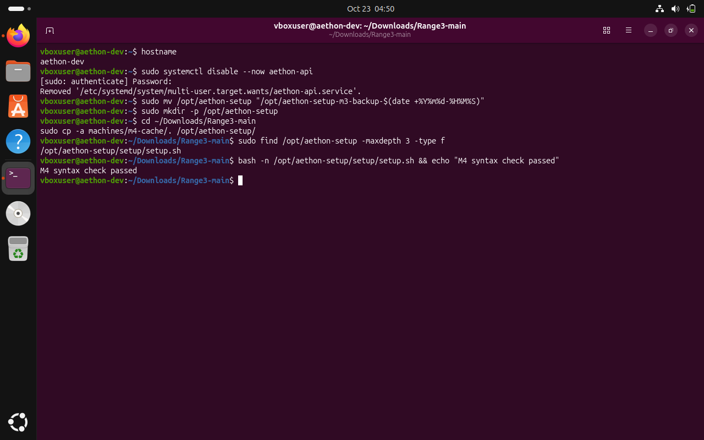

### Evidence 02 — Default redis-server disabled in the staged installer to prevent a port conflict

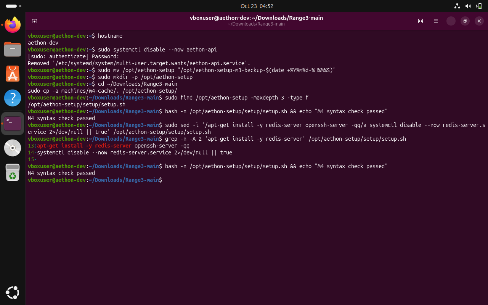

### Evidence 03 — M4 installer completed; Redis on port 6379 without authentication

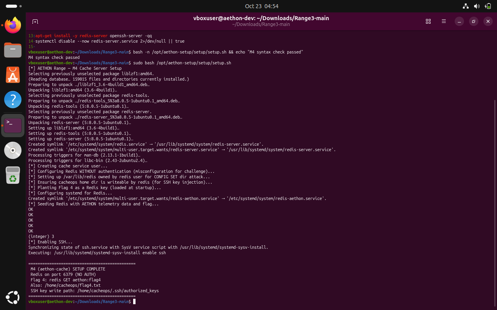

### Evidence 04 — M4 Redis service active; local PING, key count and Host-only IP verified

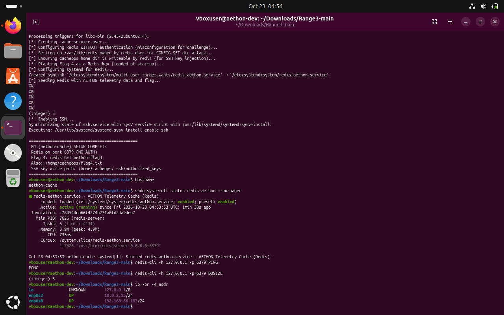

### Evidence 05 — Redis tools installed on M3; cross-VM PING and Flag 4 retrieval succeeded

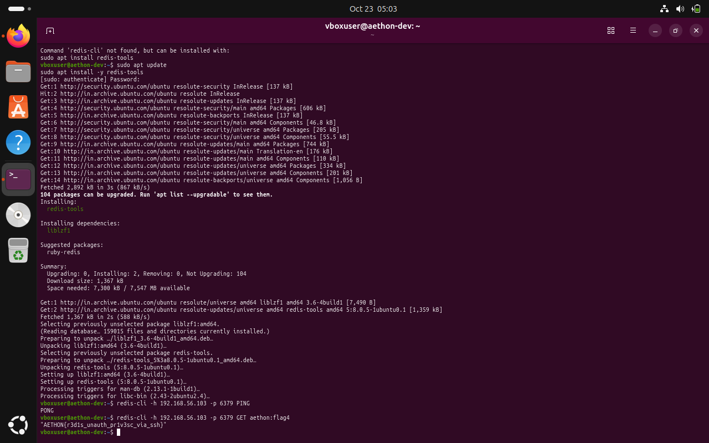

### Evidence 06 — Redis keys, version and initial runtime settings inspected

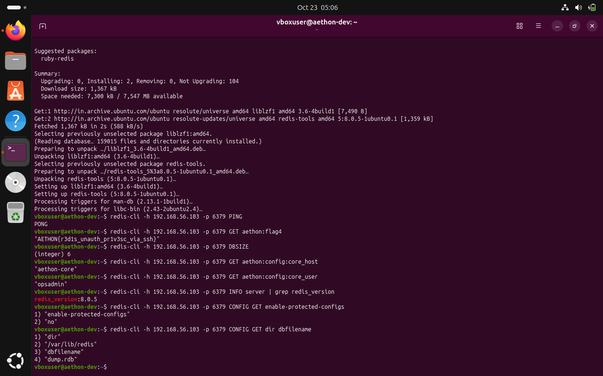

### Evidence 07 — M4 SSH directory inspection — authorized_keys was absent

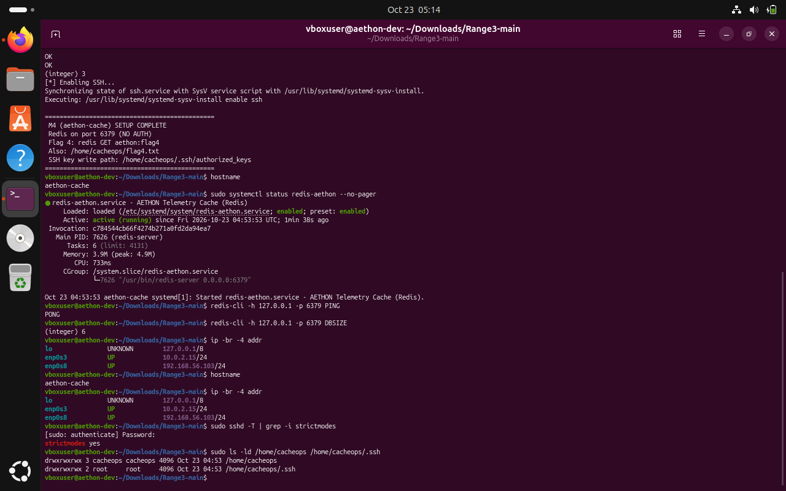

### Evidence 08 — M3 key-pair preparation and Redis reachability; no successful file write shown

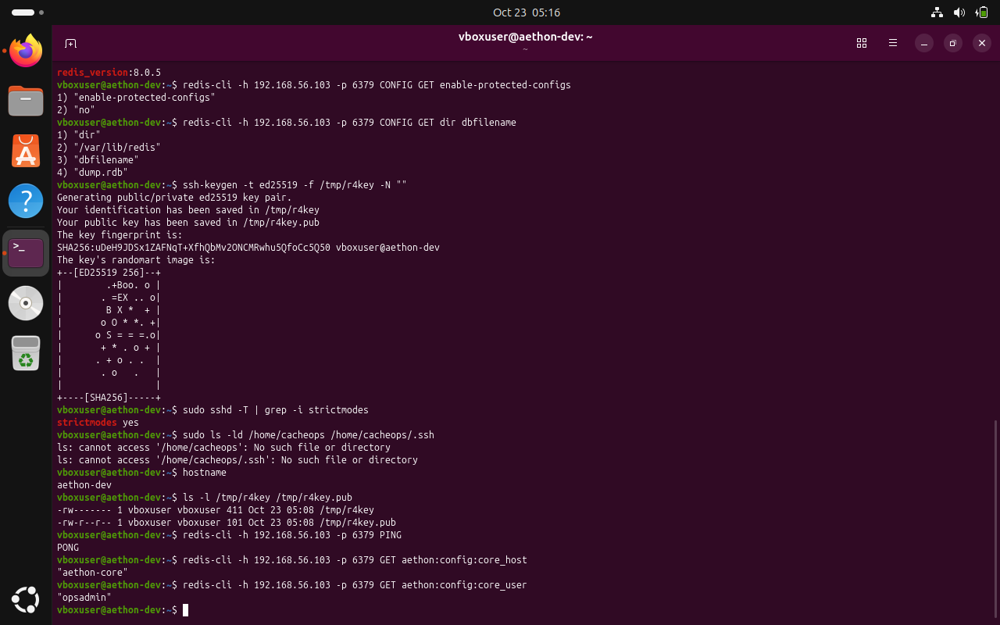

### Evidence 09 — Repeated M4 inspection confirmed authorized_keys was absent

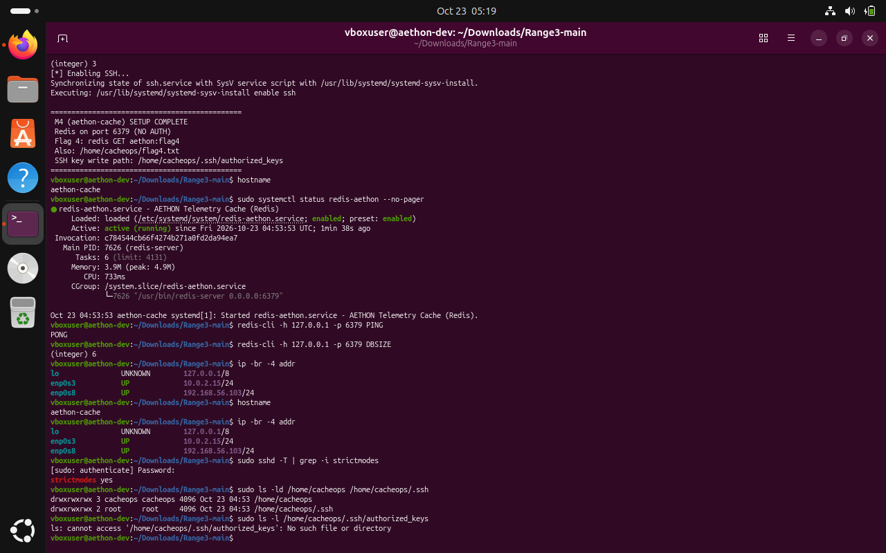

### Evidence 10 — Runtime CONFIG SET attempt rejected because the option was immutable

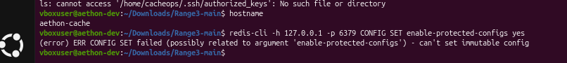

### Evidence 11 — Redis configuration opened for a local setting adjustment

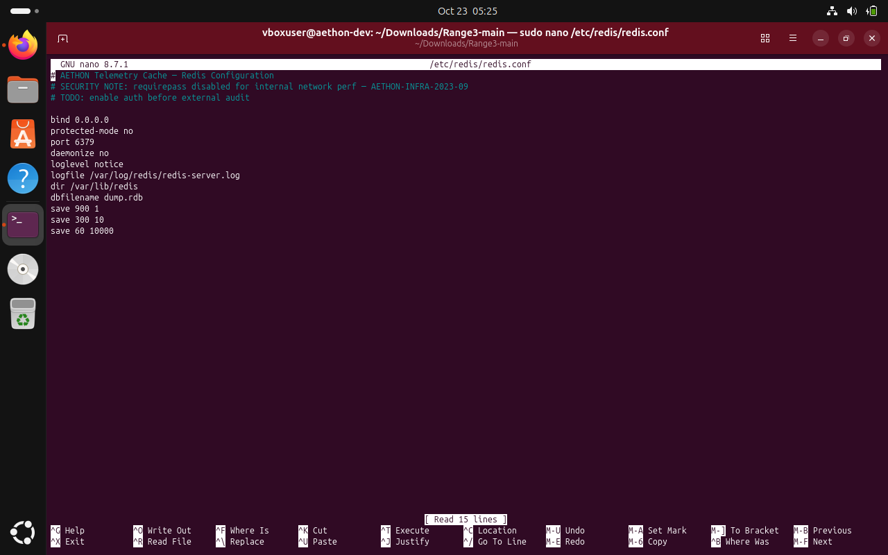

### Evidence 12 — Redis restarted after the configuration edit

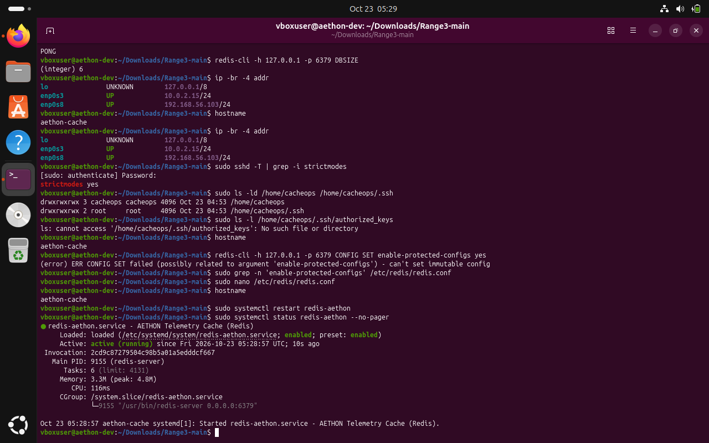

### Evidence 13 — Post-restart verification: protected-config setting yes, PING and flag lookup still work

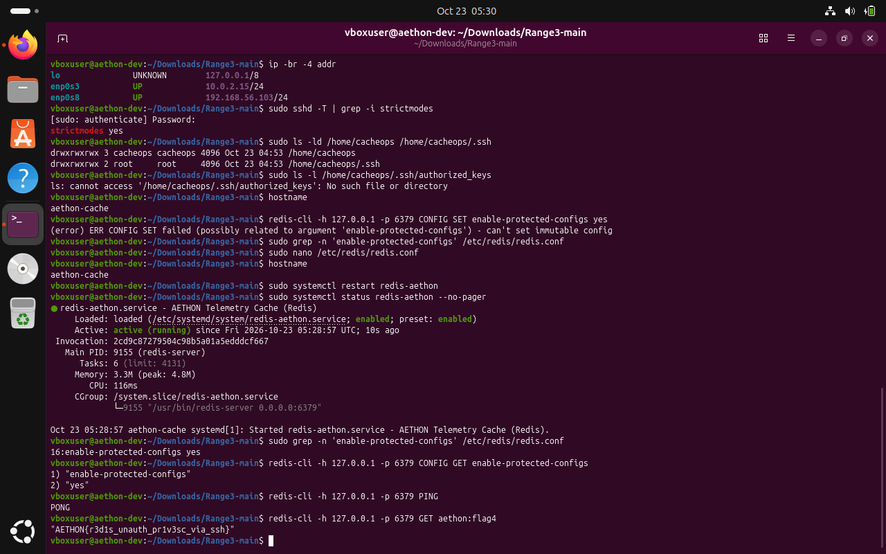

### Evidence 14 — M3-side path check included for completeness; it does not prove M4 filesystem state

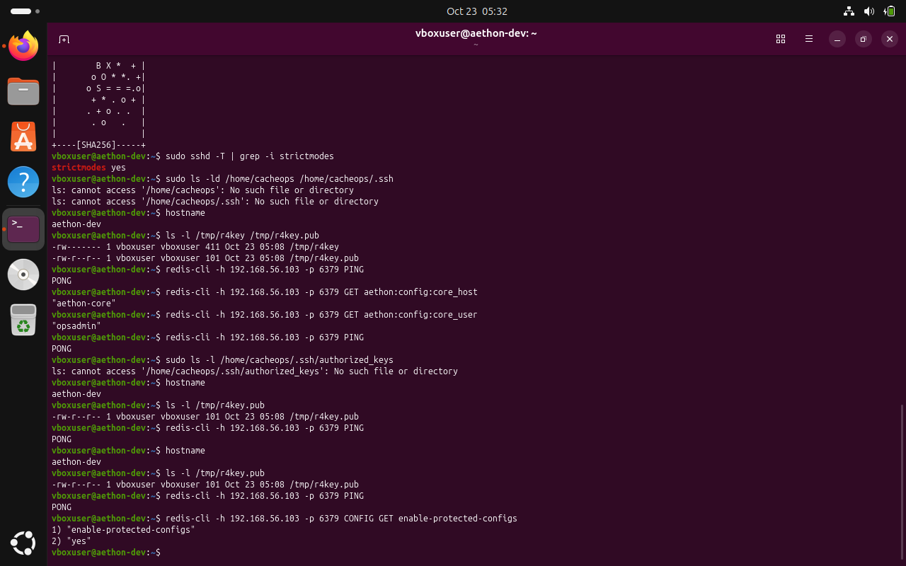

### Evidence 15 — Redis persistence status inspected; dir and dbfilename remained /var/lib/redis and dump.rdb

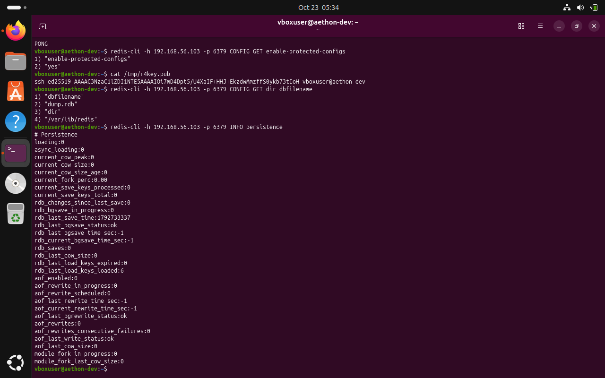

### Evidence 16 — Latest M4-local check: /home/cacheops/.ssh/authorized_keys still absent

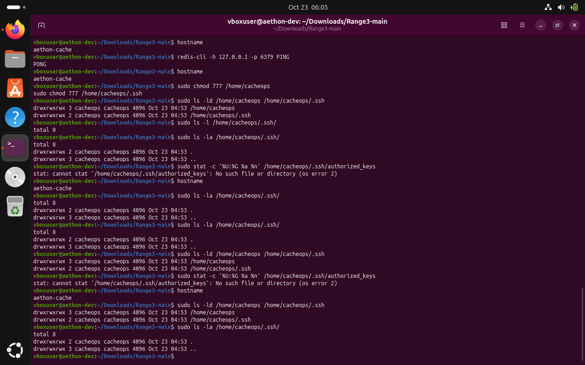
